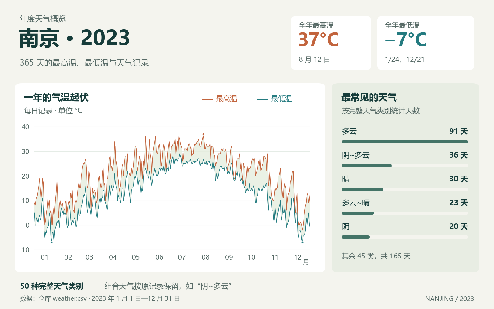

# Nanjing Weather in 2023: Visualizations

[简体中文](README.md) · **English** · [Español](README.es.md) · [日本語](README.ja.md)

Explore a saved set of daily weather records for Nanjing in 2023. The project validates the dates and temperatures, then generates five chart types for each month and an annual word cloud. The dataset contains **365 unique dates and 50 distinct weather labels**; the album contains **61 generated charts**.

**[Browse the charts](outputs/verified-20261015/)** · [Notebook](WeatherForNanjing.ipynb) · [Validation record](docs/optimization-validation.md)



The overview uses all 365 records in `weather.csv`. Daily high and low temperatures appear on the left and the five most frequent whole weather labels on the right.

## Generate the charts offline

Use Python 3.10. The plot command reads local files and does not make network requests:

```powershell
python -m pip install -r requirements.txt
python -B WeatherForNanjing.py plot --input weather.csv --encoding gb18030 --year 2023 --font C:\Windows\Fonts\simhei.ttf --output outputs\my-run
```

Specify the input, font and a new output directory. On Linux or other systems, provide a local font that supports Chinese text. The result contains 61 PNGs and `manifest.json`, which records the input, font, image checksums and dependency versions.

The historical CSV uses GB18030 and `YYYY/M/D` dates. For a newer UTF-8 CSV, pass `--encoding utf-8`. The loader normalizes dates, integer Celsius temperatures and weather labels. Missing columns, duplicate or missing dates, unknown date formats and invalid temperatures fail explicitly; the program does not fill in observations.

## How to read the charts

| Chart | Meaning |
| --- | --- |
| Line chart | Day of the month on the horizontal axis; high temperatures in red and lows in blue, in °C |
| Scatter plot | Two observations per day; fixed colors and markers distinguish highs from lows |
| Pie chart | Number and share of days per whole weather label; the legend gives the actual counts |
| Heatmap | One column per day, colored by high minus low temperature, in °C |
| 3D scatter plot | Date, high and low on the axes; color represents the daily temperature range |
| Annual word cloud | Frequency of each day's whole weather label; 50 labels across 365 days |

A compound label such as “多云~晴” (cloudy to clear) counts as a single category for that day. The word cloud neither combines text across dates nor adds fabricated observations.

## Notebook and verification

The notebook sets parameters and calls the same `nanjing_weather.plots.run_offline` function as the script. Set the input, font and a new output directory, then run all cells. To install the notebook dependencies and run the checks:

```powershell
python -m pip install -r requirements-notebook.txt
python -B -m unittest discover -s tests -v
python -B tools\verify_notebook.py --output outputs\notebook-check --reference outputs\verified-20261015 --evidence outputs\notebook-check.json
```

In the recorded notebook run, all 61 PNG SHA-256 hashes matched the script output. The [validation report](docs/optimization-validation.md) describes the environment, checks and scope. The [archived notebook](archive/WeatherForNanjing.original.ipynb) preserves the original notebook and its outputs.

## Collect data separately

Fetching pages and parsing HTML are separate operations. Only the explicit `collect` command makes network requests. Check the source site's access rules before running it:

```powershell
python -B WeatherForNanjing.py collect --year 2023 --output weather-new.csv --timeout 10 --max-attempts 3 --interval 1
```

HTTP failures and timeouts identify the affected month; retries are bounded and logged. Empty, blocked or structurally changed pages fail even if they return HTTP 200. The command writes a new UTF-8 CSV only after all twelve months validate, and it never overwrites an existing file.

Offline parser tests use handcrafted HTML fixtures for valid and invalid pages. A real monthly request timed out after 15 seconds without returning usable HTML; the year was not collected again. The [source probe record](docs/network-probe.json) identifies the collection endpoint at `lishi.tianqi.com` and documents the failed probe.

## Files, data and reuse

- `nanjing_weather/`: data contract, offline loading, HTML parsing, HTTP fetching and plotting.
- `WeatherForNanjing.py` and `WeatherForNanjing.ipynb`: two entry points to the same offline workflow.
- `weather.csv`: the unchanged historical GB18030 dataset.
- `outputs/verified-20261015/`: charts and verification metadata from a recorded run.
- `结果图/`, original images and `archive/`: historical materials.
- `tests/`: checks for invalid data, parsing changes, network failures and output protection.

The [preservation manifest](docs/preserved-files.json) records hashes for 64 files. Verify it with `python -B tools\record_preserved_files.py --verify`. This repository does not specify a license; check the relevant rights and source terms before reusing or redistributing the code, historical data or images.
