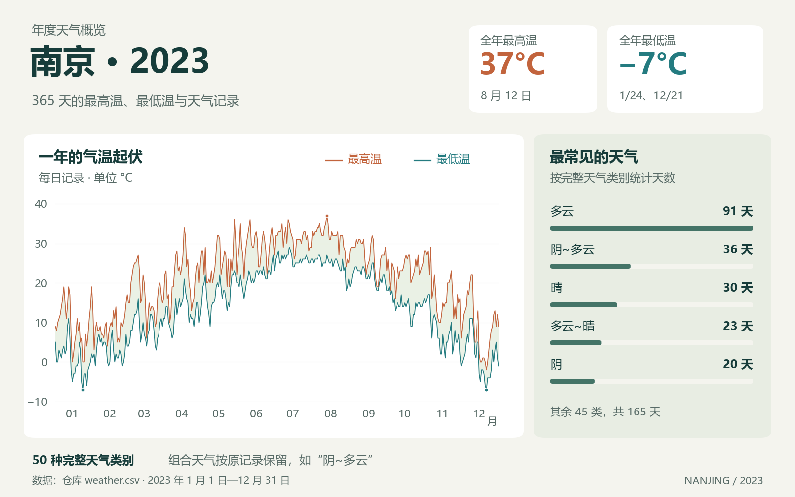

# El tiempo en Nankín en 2023: visualizaciones

[简体中文](README.md) · [English](README.en.md) · **Español** · [日本語](README.ja.md)

Explora un conjunto de registros meteorológicos diarios de Nankín de 2023. El proyecto valida las fechas y temperaturas y genera cinco tipos de gráficos por mes y una nube de palabras anual. La muestra contiene **365 fechas únicas y 50 categorías meteorológicas completas**; el álbum reúne **61 gráficos generados**.

**[Ver los gráficos](outputs/verified-20261015/)** · [Cuaderno Jupyter](WeatherForNanjing.ipynb) · [Registro de validación](docs/optimization-validation.md)



El gráfico resumen usa los 365 registros de `weather.csv`. A la izquierda aparecen las temperaturas máximas y mínimas diarias; a la derecha, las cinco categorías completas más frecuentes.

## Generar los gráficos sin conexión

Usa Python 3.10. El comando de visualización lee archivos locales y no hace peticiones de red:

```powershell
python -m pip install -r requirements.txt
python -B WeatherForNanjing.py plot --input weather.csv --encoding gb18030 --year 2023 --font C:\Windows\Fonts\simhei.ttf --output outputs\my-run
```

Indica el archivo de entrada, la fuente tipográfica y un directorio de salida que todavía no exista. En Linux u otros sistemas, usa una fuente local compatible con caracteres chinos. Se generan 61 archivos PNG y `manifest.json`, que registra la entrada, la fuente, las sumas de verificación de las imágenes y las versiones de las dependencias.

El CSV histórico usa GB18030 y fechas `YYYY/M/D`. Para un nuevo CSV en UTF-8, indica `--encoding utf-8`. Los datos se normalizan como fechas, temperaturas enteras en grados Celsius y categorías meteorológicas. Las columnas ausentes, las fechas duplicadas o faltantes, los formatos de fecha desconocidos y las temperaturas no válidas producen un error; no se inventan observaciones.

## Cómo leer los gráficos

| Gráfico | Significado |
| --- | --- |
| Líneas | Día del mes en el eje horizontal; máximas en rojo y mínimas en azul, en °C |
| Dispersión | Dos observaciones por día; colores y símbolos fijos distinguen máximas y mínimas |
| Sectores | Número y proporción de días por categoría completa; la leyenda indica los recuentos |
| Mapa de calor | Una columna por día; el color representa la máxima menos la mínima, en °C |
| Dispersión 3D | Fecha, máxima y mínima en los ejes; el color representa la amplitud térmica diaria |
| Nube de palabras anual | Frecuencia de cada categoría completa; 50 categorías en 365 días |

Una etiqueta compuesta como «多云~晴» (de nuboso a despejado) cuenta como una única categoría para ese día. La nube de palabras no combina texto de fechas distintas ni incorpora observaciones inventadas.

## Cuaderno Jupyter y verificación

El cuaderno configura los parámetros y llama a la misma función `nanjing_weather.plots.run_offline` que el script. Ajusta la entrada, la fuente y un directorio de salida nuevo y ejecuta todas las celdas. Para instalar las dependencias del cuaderno y ejecutar las comprobaciones:

```powershell
python -m pip install -r requirements-notebook.txt
python -B -m unittest discover -s tests -v
python -B tools\verify_notebook.py --output outputs\notebook-check --reference outputs\verified-20261015 --evidence outputs\notebook-check.json
```

En la ejecución registrada, las sumas SHA-256 de los 61 PNG coincidieron con las de la ejecución del script. El [informe de validación](docs/optimization-validation.md) describe el entorno, las pruebas y su alcance. El [cuaderno archivado](archive/WeatherForNanjing.original.ipynb) conserva el original con sus resultados.

## Recopilación independiente

La descarga de páginas y el análisis de HTML se implementan por separado. Solo el comando explícito `collect` accede a la red. Comprueba las condiciones de acceso del sitio de origen antes de ejecutarlo:

```powershell
python -B WeatherForNanjing.py collect --year 2023 --output weather-new.csv --timeout 10 --max-attempts 3 --interval 1
```

Los errores HTTP y los tiempos de espera agotados indican el mes afectado; los reintentos son limitados y quedan registrados. Las páginas vacías, bloqueadas o con cambios de estructura fallan incluso si responden con HTTP 200. El comando escribe un CSV nuevo en UTF-8 solo después de validar los doce meses y nunca sobrescribe el archivo de destino.

Las pruebas sin conexión usan ejemplos HTML preparados para páginas válidas y no válidas. Una petición real de un mes agotó su tiempo de espera a los 15 segundos sin obtener HTML utilizable; no se volvió a recopilar el año entero. El [registro de la prueba de acceso](docs/network-probe.json) identifica el origen de la consulta en `lishi.tianqi.com` y documenta el fallo.

## Archivos, datos y reutilización

- `nanjing_weather/`: contrato de datos, carga sin conexión, análisis HTML, peticiones HTTP y gráficos.
- `WeatherForNanjing.py` y `WeatherForNanjing.ipynb`: dos entradas al mismo proceso sin conexión.
- `weather.csv`: datos históricos en GB18030, sin cambios.
- `outputs/verified-20261015/`: gráficos y datos de verificación de una ejecución registrada.
- `结果图/`, imágenes originales y `archive/`: materiales históricos.
- `tests/`: pruebas de datos inválidos, cambios de formato, fallos de red y protección de las salidas.

El [registro de conservación](docs/preserved-files.json) contiene las sumas de verificación de 64 archivos. Para comprobarlas, ejecuta `python -B tools\record_preserved_files.py --verify`. El repositorio no especifica una licencia; verifica los derechos y las condiciones de las fuentes antes de reutilizar o redistribuir el código, los datos históricos o las imágenes.
