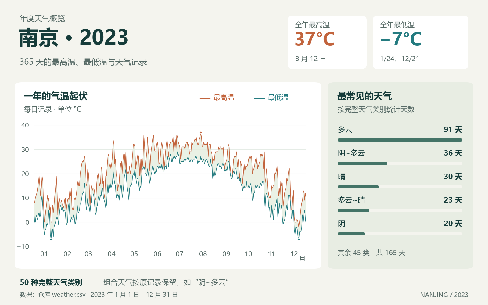

# 南京の2023年の天気を可視化する

[简体中文](README.md) · [English](README.en.md) · [Español](README.es.md) · **日本語**

保存済みの南京の2023年の日別天気データから、日付と気温を検証し、各月について5種類のグラフと年間のワードクラウドを生成します。データは **重複のない365日分、50種類の天気区分** で、生成済みの図は **計61枚** です。

**[生成済みの図を見る](outputs/verified-20261015/)** · [Jupyter Notebook](WeatherForNanjing.ipynb) · [検証記録](docs/optimization-validation.md)



概要図には `weather.csv` の365日分を使用しています。左は日別の最高・最低気温、右は出現頻度が高い5つの天気区分です。

## オフラインで図を生成する

Python 3.10 を使用します。描画コマンドはローカルファイルを読み取り、ネットワークには接続しません。

```powershell
python -m pip install -r requirements.txt
python -B WeatherForNanjing.py plot --input weather.csv --encoding gb18030 --year 2023 --font C:\Windows\Fonts\simhei.ttf --output outputs\my-run
```

入力ファイル、フォント、まだ存在しない出力ディレクトリを指定します。Linux などでは、中国語を表示できるローカルのフォントファイルを指定してください。出力は61枚の PNG と、入力、フォント、画像のチェックサム、依存関係のバージョンを記録した `manifest.json` です。

保存済み CSV の文字コードは GB18030、日付形式は `YYYY/M/D` です。新しく収集した UTF-8 の CSV には `--encoding utf-8` を指定します。内部では日付、整数の摂氏温度、天気区分を統一した形式で扱います。列の不足、日付の重複・欠落、不明な日付形式、不正な気温はエラーになり、観測値の補完は行いません。

## グラフの読み方

| グラフ | 内容 |
| --- | --- |
| 折れ線グラフ | 横軸は日付。赤線は最高気温、青線は最低気温（℃） |
| 散布図 | 1日につき2点。色とマーカーで最高・最低気温を区別 |
| 円グラフ | 天気区分ごとの日数と月内の割合。凡例に実際の日数を表示 |
| ヒートマップ | 1列が1日。色は最高気温と最低気温の差（℃） |
| 3次元散布図 | 軸は日付・最高気温・最低気温。色は日内の気温差 |
| 年間ワードクラウド | 各日の天気区分の出現頻度。50区分で計365日 |

「多云~晴」（曇りから晴れ）のような複合表記も、1日分の1区分として数えます。ワードクラウドでは、異なる日の文字列をつなぎ合わせたり、観測値を追加したりしていません。

## Notebook と検証

Notebook はパラメーターを設定し、スクリプトと共通の `nanjing_weather.plots.run_offline` を呼び出します。入力、フォント、新しい出力ディレクトリを指定して全セルを実行してください。Notebook の依存関係のインストールと検証には、次のコマンドを使用します。

```powershell
python -m pip install -r requirements-notebook.txt
python -B -m unittest discover -s tests -v
python -B tools\verify_notebook.py --output outputs\notebook-check --reference outputs\verified-20261015 --evidence outputs\notebook-check.json
```

記録済みの実行では、Notebook とスクリプトが生成した61枚の PNG すべてで SHA-256 が一致しました。[検証レポート](docs/optimization-validation.md)に実行環境、検証手順、検証範囲を記録しています。[アーカイブ](archive/WeatherForNanjing.original.ipynb)には当初の Notebook とその出力を保存しています。

## データ収集は別途実行する

ページの取得と HTML の解析は分離されています。ネットワークにアクセスするのは `collect` を明示的に実行した場合だけです。実行前に取得元サイトのアクセス条件を確認してください。

```powershell
python -B WeatherForNanjing.py collect --year 2023 --output weather-new.csv --timeout 10 --max-attempts 3 --interval 1
```

HTTP エラーやタイムアウトでは該当月を報告します。再試行の回数には上限があり、ログに記録されます。HTTP 200 でも、空の一覧、アクセスが遮断されたページ、構造が変わったページはエラーになります。12か月すべての検証が完了した場合にのみ新しい UTF-8 の CSV を出力し、既存のファイルは上書きしません。

オフラインの解析テストには、正常・異常ページを再現した手作りの HTML を使用しています。実際の月別ページへのリクエストは15秒でタイムアウトし、解析可能な HTML は得られませんでした。年間データの再収集は行っていません。[接続確認の記録](docs/network-probe.json)に取得先の `lishi.tianqi.com` と失敗の詳細を記録しています。

## ファイル、データ、再利用

- `nanjing_weather/`：データ仕様、オフライン読み込み、HTML 解析、HTTP 取得、描画。
- `WeatherForNanjing.py` と `WeatherForNanjing.ipynb`：共通のオフライン処理への2つの入口。
- `weather.csv`：変更していない過去の GB18030 データ。
- `outputs/verified-20261015/`：実際の実行で生成した図と検証記録。
- `结果图/`、元の画像、`archive/`：過去の資料。
- `tests/`：データの異常、HTML 構造の変化、ネットワーク障害、出力先の保護に関する検証。

[保存ファイルの照合リスト](docs/preserved-files.json)には64ファイルのチェックサムがあり、`python -B tools\record_preserved_files.py --verify` で照合できます。リポジトリにライセンスの明示はありません。コード、過去のデータ、画像を再利用・再配布する際は、各資料の権利と取得元の条件を確認してください。
