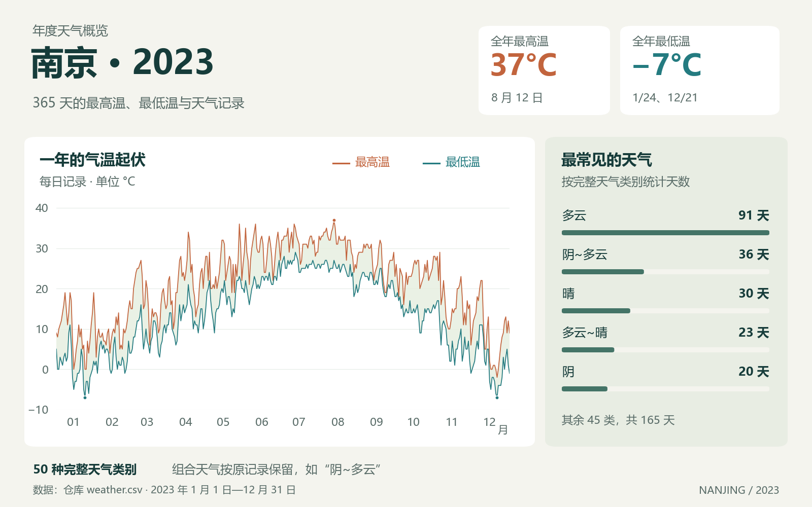

# 南京 2023 年天气可视化

使用保存的南京 2023 年天气记录，校验全年日期与温度，生成五类月图及年度天气类别词云。当前样本有 **365 个唯一日期、50 个完整天气类别**，五类图各覆盖十二个月，加词云共 **61 张新图**。

**[查看新图](outputs/verified-20261015/)** · [Notebook](WeatherForNanjing.ipynb) · [验证记录](docs/optimization-validation.md)



基于 `weather.csv` 的全年 365 条记录：左侧为每日最高温与最低温，右侧为最常见的五种完整天气类别。

## 离线运行

Python 3.10。绘图读取现有文件，不发网络请求：

```powershell
python -m pip install -r requirements.txt
python -B WeatherForNanjing.py plot --input weather.csv --encoding gb18030 --year 2023 --font C:\Windows\Fonts\simhei.ttf --output outputs\my-run
```

输入、字体和输出目录均为显式参数。输出目录必须尚不存在；Linux 或其他系统需提供本机可用的中文字体文件。输出含 61 张 PNG，以及记录输入、字体、图片校验值和依赖版本的 `manifest.json`。

原 CSV 使用 GB18030 和 `YYYY/M/D` 日期；UTF-8 的新采集文件应传 `--encoding utf-8`。内部日期、整数摄氏度和天气类别采用统一结构。缺列、重复或缺失日期、未知日期格式、非法温度均明确报错，不填造数据。

## 图中各元素代表什么

| 图形 | 数据含义 |
| --- | --- |
| 折线图 | 横轴为当月日期，红线最高温、蓝线最低温，单位 ℃ |
| 散点图 | 每天两个温度观测点，固定颜色与形状区分最高温、最低温 |
| 饼图 | 完整天气类别的天数与占当月比例，图例给出实际天数 |
| 热力图 | 每列对应一天，颜色为最高温减最低温，单位 ℃ |
| 三维散点图 | 三轴为日期、最高温、最低温，颜色对应当日温差 |
| 年度词云 | 按每天完整天气类别的频数生成，50 类合计 365 天 |

组合天气（如“多云~晴”）保留为一天的一个完整类别。词云没有把不同日期拼接后再分词，也没有增加虚构观测。

## Notebook 与验证

Notebook 只设置参数并调用同一个 `nanjing_weather.plots.run_offline`，不复制加载和绘图实现。先修改 Notebook 的输入、字体、新输出目录，再运行所有单元格。需要执行依赖时：

```powershell
python -m pip install -r requirements-notebook.txt
python -B -m unittest discover -s tests -v
python -B tools\verify_notebook.py --output outputs\notebook-check --reference outputs\verified-20261015 --evidence outputs\notebook-check.json
```

本机实际执行 Notebook 后，61 张 PNG 均与脚本的图片 SHA-256 一致。[验证报告](docs/optimization-validation.md)记录环境、检查方式和适用范围。历史 Notebook 及其原有输出完整保存在 [archive/WeatherForNanjing.original.ipynb](archive/WeatherForNanjing.original.ipynb)。

## 独立采集

网页获取和 HTML 解析分别实现。只有显式执行采集命令才联网，使用前需核实目标站点的访问规则：

```powershell
python -B WeatherForNanjing.py collect --year 2023 --output weather-new.csv --timeout 10 --max-attempts 3 --interval 1
```

状态码或超时失败会报出失败月份，重试次数有上限且记录日志；HTTP 200 的空列表、被拦截页面或结构变化同样失败。全部十二个月校验通过后才写入新的 UTF-8 CSV，既有文件不会被覆盖。

离线测试使用保存的人工 HTML 解析夹具，覆盖正常结构和错误页面。一次真实月度请求在 15 秒后读取超时，未取得可解析页面；本轮没有重新采集全年。[源站探测记录](docs/network-probe.json)保留这次失败，不将离线测试当成在线采集成功。

## 文件

- `nanjing_weather/`：数据契约、离线加载、HTML 解析、HTTP 获取与绘图。
- `WeatherForNanjing.py`、`WeatherForNanjing.ipynb`：同一离线流程的两种入口。
- `weather.csv`：未改动的历史 GB18030 数据。
- `outputs/verified-20261015/`：本次实际生成的新图和校验记录。
- `结果图/`、原始图片、`archive/`：保留历史材料。
- `tests/`：数据异常、解析变化、网络失败及输出保护测试。

[历史文件校验清单](docs/preserved-files.json)记录 64 个文件，可运行 `python -B tools\record_preserved_files.py --verify` 复核。
